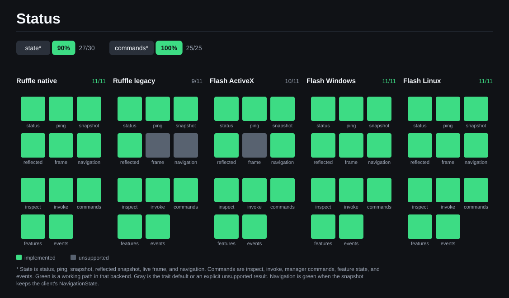

# xenomit-game-api

This crate gives behavior engines one client-agnostic interface for reading
game state and invoking client functions. The Ruffle, Flash ActiveX, and
native Flash backends each implement the part of `GameClient` their client
can support.

<!-- backend-status:start -->
## Backend coverage

`scripts/backend_status.py` reads each `GameClient` implementation and redraws this picture. Gitea runs it on every push to `main` and commits the picture when coverage changes.

| Capability | Ruffle native | Ruffle legacy | Flash ActiveX | Flash Windows | Flash Linux |
| --- | --- | --- | --- | --- | --- |
| Status | yes | yes | yes | yes | yes |
| Ping | yes | yes | yes | yes | yes |
| Snapshot | yes | yes | yes | yes | yes |
| Reflected snapshot | yes | yes | yes | yes | yes |
| Live frame | yes | no | no | yes | yes |
| Navigation | yes | no | yes | yes | yes |
| Inspect | yes | yes | yes | yes | yes |
| Invoke | yes | yes | yes | yes | yes |
| Commands | yes | yes | yes | yes | yes |
| Features | yes | yes | yes | yes | yes |
| Events | yes | yes | yes | yes | yes |

<!-- backend-status:end -->

## Backends

`connect(pid, backend)` selects the implementation:

- `ClientBackend::Native` (default) — `NativeClient`. Snapshots come from the
  player's per-frame shared-memory capture and calls use the native
  `NINVOKE`/`NFINVOKE` commands, so routine polling never runs AS3 code or
  stalls the game. `snapshot(None)` returns `Err(ApiError::Unavailable)`
  until the player publishes shared memory; there is no silent pipe
  fallback. A player that answers `ERR unknown command` to `NINVOKE` is too
  old for this backend — use `LegacyPipe`.
- `ClientBackend::LegacyPipe` — `LegacyPipeClient`. The original AS3
  reflection commands (`STATE`, `INSPECT`, `INVOKE`, `FINVOKE`) over the
  named pipe. Every request runs on the player thread and stalls the game
  (~200 ms per snapshot); kept for compatibility with old clients and for
  diagnostics/reflected targets.

`GameClient::read_live_frame` fills a `LiveFrame` without blocking on the
native backend and returns false on legacy; `LiveFrame::from_game_snapshot`
shapes a legacy `STATE` snapshot into the same frame type for renderers.

## Connect to xenomit-client

Start the client with its bridge enabled (the default), then connect using
its process ID:

    use xenomit_game_api::{CallTiming, ClientBackend, FunctionCall, GameClient, connect};
    use serde_json::json;

    fn read_and_move(pid: u32) -> Result<(), Box<dyn std::error::Error>> {
        let client = connect(pid, ClientBackend::Native)?;
        let status = client.status()?;
        if !status.ready {
            return Err("xenomit bridge is not ready".into());
        }

        let snapshot = client.snapshot(None)?;
        for entity in &snapshot.entities {
            println!("{} at ({}, {})", entity.class_name, entity.position.x, entity.position.y);
        }

        let move_call = FunctionCall {
            target: "GameClassOrSingleton".into(),
            function: "moveHeroToCordinates".into(),
            arguments: vec![json!(800), json!(500)],
            timing: CallTiming::InFrame,
        };
        client.call_function(&move_call)?;
        Ok(())
    }

Construct a backend directly when the trait object is not needed:

    let native = xenomit_game_api::NativeClient::connect(pid)?;
    let legacy = xenomit_game_api::LegacyPipeClient::connect(pid)?;

Use the bridge's reflected target and argument conventions for a given game
action. The crate intentionally does not guess a target path or argument
signature.

### Native paths

On the native backend `CallTiming::InFrame` maps to `NFINVOKE` and
`Immediate` to `NINVOKE`: the player resolves the target and calls the
method natively in the AVM2 graph, so the `DobotBridge` AS3 blob is not
required. `inspect` and `snapshot(Some(target))` still delegate to the AS3
reflection commands — member/target reflection is inherently AS3-side.

### Live shared-memory snapshots

`xenomit-client` publishes a per-frame capture of the live map to the
`Local\xenomit_state_<pid>` file mapping (see `live::layout` for the wire
format — seqlock header + fixed-size entity records + a string table).
`NativeClient::snapshot(None)` returns `LiveFrame::to_game_snapshot()` for
the newest fresh frame (< 2 s old), so polling never stalls the player.
`NativeClient::live()` exposes `Arc<LiveStateReader>` for callers that want
raw 60 Hz frames (use `read_into` to reuse allocations), and
`GameClient::read_live_frame` gives the same access through the trait.

## Shared API

Behavior-engine code should accept &dyn GameClient and use shared types such
as GameSnapshot, GameEntity, and FunctionCall. Another client adapter can
provide its own state/action translation while keeping that behavior-engine
code unchanged.

Snapshots from the current bridge contain the active map ID/name, world size,
hero world position, and map safe places when the game map is ready. The
snapshot also contains visible entities; their normalized position and bounds
use stage pixels, while world coordinates remain in `GameEntity::fields`.
`truncated` describes the display-list fallback when no game map is active.
Common health, shield, and identifier aliases are normalized; all original
bridge fields are also retained in `GameEntity::fields`.

## Behavior engine boundary

Desktop controllers can pass `Arc<dyn GameClient>` and a `ModuleConfig` to a
`BehaviorRuntime`. The runtime owns behavior scheduling and receives module
settings as JSON, leaving its per-module schema with the engine.

`BehaviorRuntime::modules()` discovers immutable `ModuleDescriptor`s and their
typed settings schemas. Dotted setting keys, validation, defaults, choices,
entity dictionaries and map selectors are shared with custom module authors.
Hosts should retain generated settings controls and discover descriptors while
the game loads; they do not need a separate hardcoded form for every module.

### Ruffle navigation and commands

Native `GameSnapshot` and `LiveFrame` include `NavigationState`: current-map
obstacles, directed map/portal links, hero/pet/items and manager observations.
These use world coordinates; the legacy display-list fallback can use stage
pixels. Geometry is valid only when `geometry_ready` is true and `map_id`
matches the current map. Missing or corrupt native navigation payloads clear
readiness rather than reusing geometry from a previous map.

`GameClient::game_command(&GameCommand)` supports typed portal jumps, pet
activation/gear, ship configuration, equipped item selection/activation and
offered free base revival on the Ruffle native backend. Other adapters return
an unavailable error unless they implement this method. Native commands follow
the game's actual request paths and validate available live state. Submission
success does not imply server-side completion; observe the resulting snapshot.

The shared-memory layout is **version 2** (2 MiB mapping). Rebuild both
`xenomit-client` and consumers after updating; version 1 clients are rejected.

### Authentic Flash ActiveX

`connect_flash(pid)` connects to the sibling `xenomit-flash-client` Windows x64
host through its dedicated local pipe. `FlashClient` implements the shared
GameClient boundary, including typed manager commands. STATE reads host-side
cached snapshots with their original capture timestamp; it never asks Flash
to reflect on a controller polling thread. Entity captures run every 150 ms;
navigation refreshes every 300 ms, inventory once per second, and the catalog
is cached for the client lifetime. Stale state is rejected.

InFrame calls execute in the injected bridge's bounded ENTER_FRAME queue and
return actual AS3 results/errors. Immediate calls still marshal to the Flash
UI thread. I/O has bounded deadlines and payload sizes, and ambiguous actions
are never retried automatically. `FlashClient::set_window_visible` and
`set_capture_enabled` support visibility and performance diagnostics.
See the sibling client's README for build/runtime requirements and measured
validation. This backend uses snapshots, not the native Ruffle shared mapping.

### Authentic Flash on Linux

`connect_flash_native(pid)` is the Linux entry point. Unscoped snapshots and
`read_live_frame` still come from the Pepper version 2 frame file, so polling
does not enter ActionScript. Reflected snapshots, inspect, invoke, typed
manager commands, feature state, and events use the same Flash verbs as the
Windows pipe, over `/tmp/xenomit_flash_<pid>.sock`. The Pepper host injects
`DobotBridge` and runs those calls on the player thread. `ping` checks that
socket; `status` stays on the frame file, so a movie that has not registered
callbacks yet can still report a live map.
